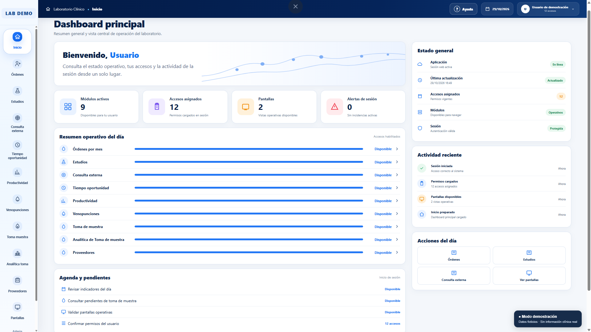
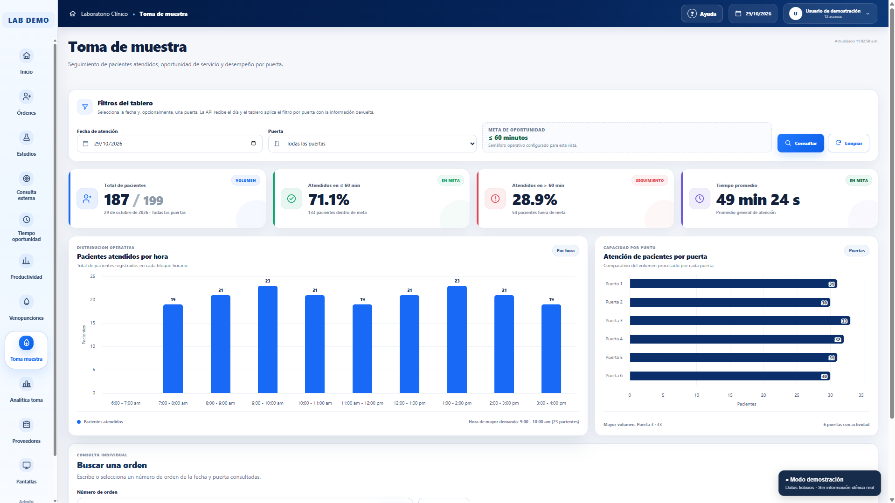
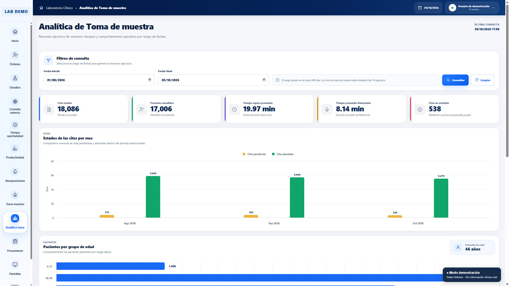
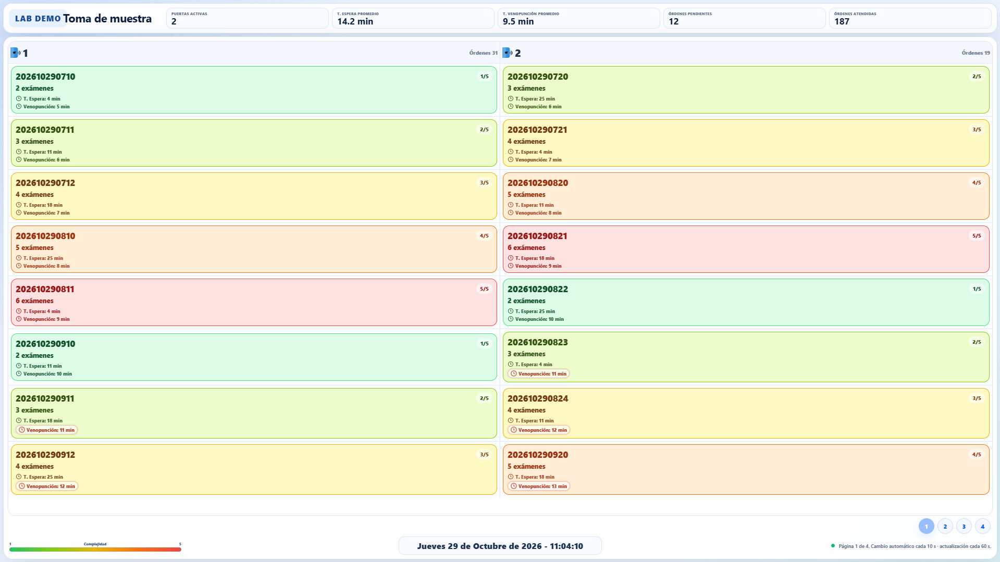
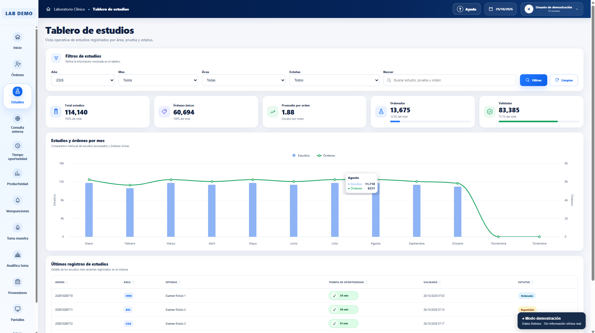
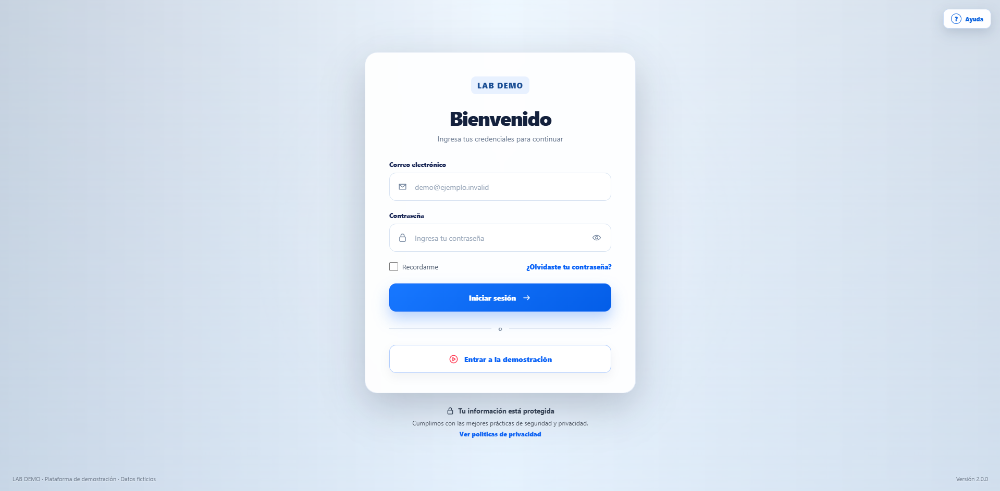

# LAB DEMO

Plataforma de demostración para el monitoreo operativo de un laboratorio clínico.

Este proyecto presenta tableros interactivos, indicadores de productividad,
seguimiento de órdenes y visualización de procesos de toma de muestra.

## Características

- Dashboard principal de operación.
- Seguimiento de órdenes y estudios.
- Consulta externa.
- Indicadores de productividad.
- Monitoreo de toma de muestra.
- Analítica de tiempos de atención.
- Pantallas operativas para TV.
- Reportes y visualizaciones.

## Tecnologías

- PHP y Laravel.
- JavaScript.
- HTML y CSS.
- Vite.
- Composer y NPM.

## Modo demostración

La demostración utiliza información ficticia.

El acceso demo está restringido a ejecución local mediante localhost
y requiere una configuración explícita.

Las operaciones administrativas de escritura están bloqueadas
durante las sesiones de demostración.

Esta versión no está preparada para exponerse como servicio público.

## Requisitos

- PHP compatible con las dependencias del proyecto.
- Composer.
- Node.js y NPM.
- Extensiones PHP requeridas por Laravel.

## Instalación local

1. Clonar o descargar el repositorio.
2. Instalar dependencias PHP:

   composer install

3. Instalar y compilar el frontend:

   npm ci
   npm run build

4. Crear el archivo de configuración local:

   copy .env.example .env

5. Generar una clave nueva:

   php artisan key:generate

6. Iniciar el servidor:

   php artisan serve --host=127.0.0.1 --port=8001

Abrir en el navegador:

http://127.0.0.1:8001/demo

El modo demostración requiere APP_ENV=local,
VCARE_DEMO_ENABLED=true y GO_API_BASE_URL vacío.

No deben utilizarse credenciales ni datos clínicos reales.

## Pruebas

Para ejecutar las pruebas de seguridad:

php artisan test --filter=DemoSecurityTest

La validación local realizada durante la preparación del
portafolio obtuvo 12 pruebas aprobadas y 19 aserciones.

Estas pruebas no sustituyen una auditoría de seguridad integral.

## Capturas

Todas las imágenes corresponden al modo demostración
y utilizan información ficticia.

### Dashboard principal

Vista general del laboratorio, indicadores operativos
y navegación entre módulos.

### Tableros operativos

| Toma de muestra | Analítica de toma de muestra |
|---|---|
|  |  |

| Pantalla operativa de TV | Tablero de estudios |
|---|---|
|  |  |

### Inicio de sesión

Interfaz de acceso y entrada a la demostración local.

## Consideraciones

- Proyecto de demostración local.
- Información de ejemplo ficticia.
- Sin integración con un backend clínico real durante el demo.
- Recursos institucionales excluidos de la copia de portafolio.

## Autoría y licencia

Pendiente de confirmar los permisos de publicación,
las atribuciones correspondientes y la licencia del proyecto.